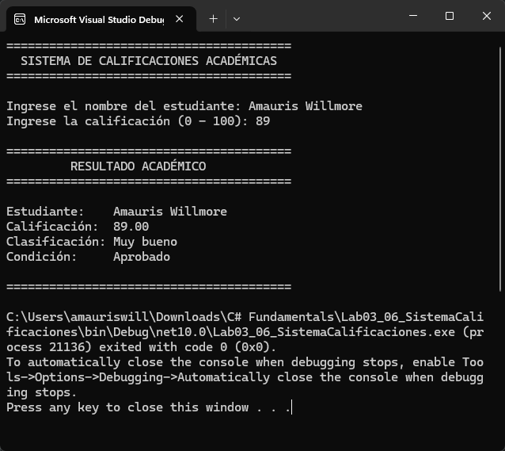

# Laboratorio 3.6 — Sistema de Calificaciones Académicas

Aplicación de consola en C# (.NET 10) que registra, valida y clasifica las calificaciones de un estudiante aplicando estructuras condicionales (`if`, `else if`, `else`), Clean Code y trazabilidad de requerimientos según el documento de negocio **BRD-CAL-002**.

## Evidencia de Ejecución en Windows Terminal

